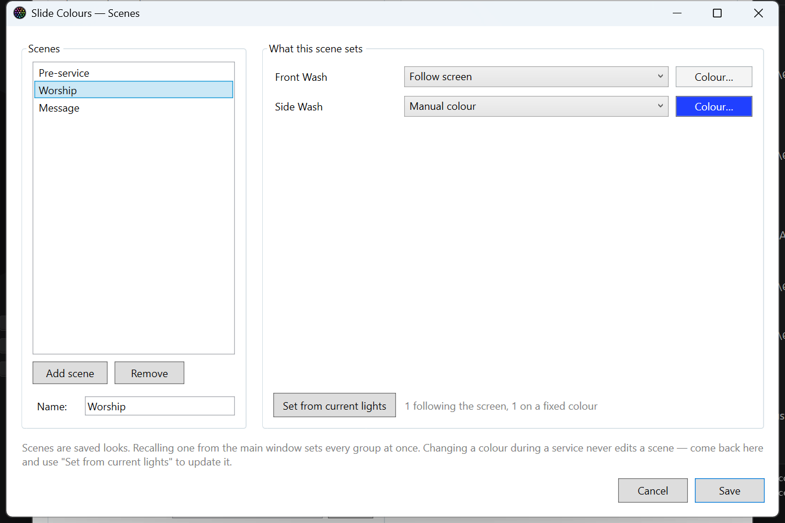
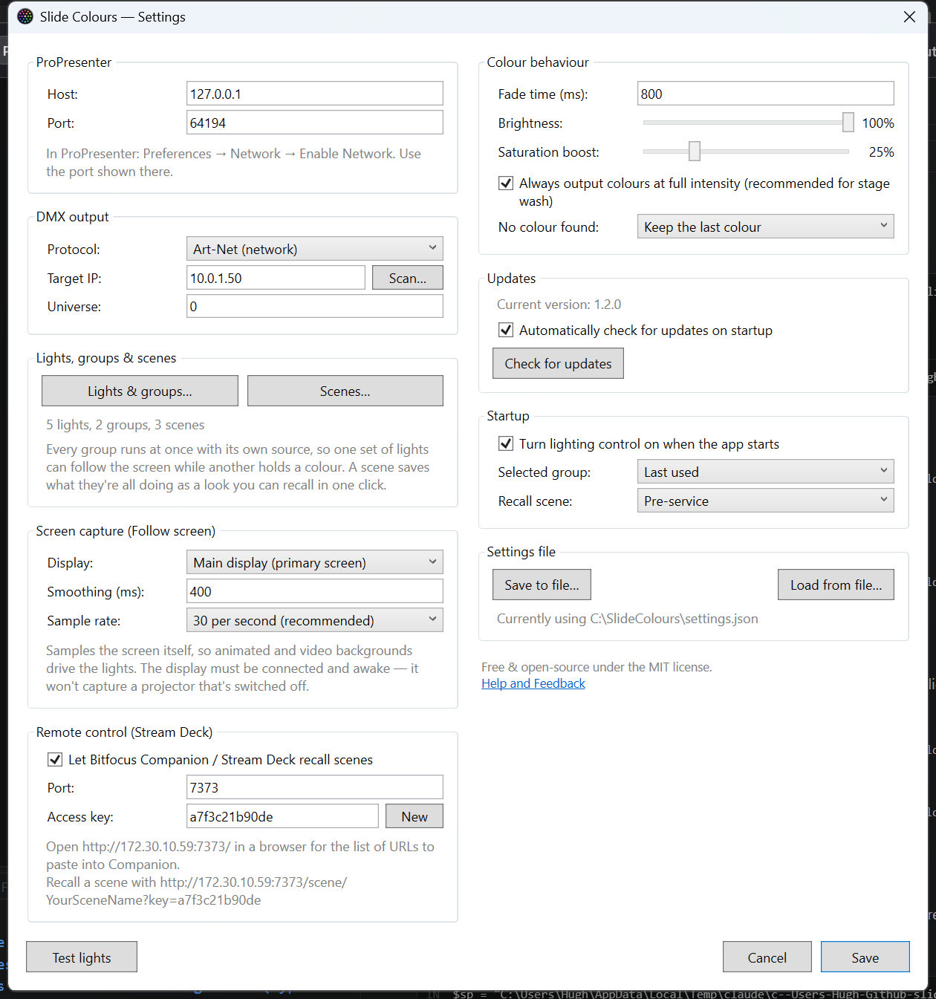
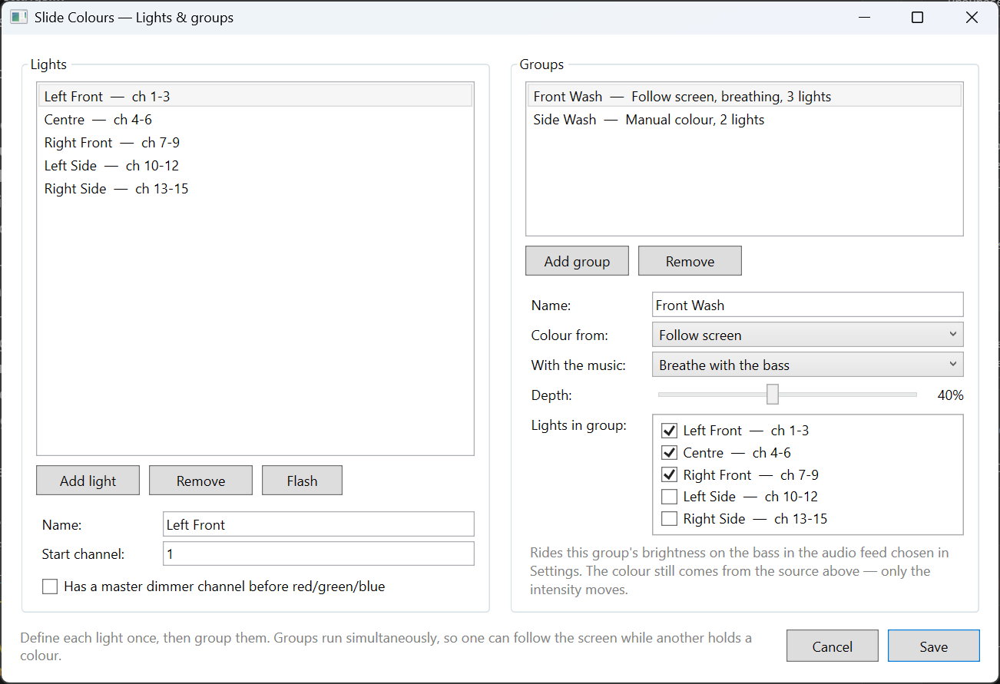

# Slide Colours

Matches your stage lighting to what's on screen. Slide Colours takes the dominant colour of what
ProPresenter is showing and streams it to your DMX rig — with a small floating on/off toggle you
can park anywhere on screen. It can follow either **the live slide** or **a display**, the latter
sampled many times a second so animated and video backgrounds drive the lights like a TV
backlight. Name your lights, group them, and each group runs on its own source — so the front wash
can follow the screen while the sides hold a colour — then save the whole stage as a **scene** you
can recall in one click. Groups can also **breathe with the music**, riding their brightness on the
bass in an audio feed while their colour keeps coming from the screen. It also doubles as a dead-simple standalone DMX
colour controller when you're not driving it from ProPresenter at all (see
[Using it as a plain DMX controller](#using-it-as-a-plain-dmx-controller)).

<p align="center">
  
</p>

## Download

**[⬇ Download the latest release](https://github.com/tango7nz/slide-colours/releases/latest)** —
grab `SlideColours.exe` and double-click it. It's fully self-contained, so there's
**nothing to install** (no .NET runtime needed) — just 64-bit Windows 10/11.

> On first launch, Windows SmartScreen may warn about an unrecognised app (the exe is unsigned).
> Click **More info → Run anyway**.

## How it works

There are two ways to get the colour, and you switch between them on the pill:

**Follow slide** — the original approach, and the lightest.

1. Listens to ProPresenter's local HTTP API for slide changes (streaming, no polling).
2. When the slide changes, fetches that slide's thumbnail and finds its dominant colour —
   biased towards vivid, saturated pixels so white lyric text and black backgrounds are ignored.

**Follow screen** — for animated backgrounds.

1. Captures a display you choose (normally the one carrying the audience/main output) using
   Windows' Desktop Duplication API, downscaling each frame on the GPU so only a few KB come
   back to the CPU. It's event-driven, so a still slide costs nothing.
2. Runs the same colour extraction on every frame, then smooths the result over time so the
   lights glide with the picture instead of stepping between hues.

Either way, the stage colour fades smoothly and DMX is transmitted ~30×/second while the toggle
is on. When toggled off, it stops transmitting so your lighting desk is back in charge.

## Requirements

- Windows 10/11 (64-bit). The [downloadable release](#download) is self-contained and needs
  nothing else installed. (Building it yourself framework-dependent instead needs the **.NET 8
  Desktop Runtime** — see [Building from source](#building-from-source).)
- For **Follow slide**: **ProPresenter 7.9 or later** with the network API enabled:
  *ProPresenter → Preferences → Network → tick **Enable Network***, then note the **port** shown there.
- For **Follow screen**: nothing extra — it uses a display already attached to this PC. (The
  screen must be connected and awake; see [Good to know](#good-to-know).)
- For **Breathing with the music**: an audio input. Nothing extra if this PC plays the music, but a
  line feed from the sound desk into a USB audio interface is much better — see
  [Choosing an audio input](#choosing-an-audio-input).
- A DMX route, one of:
  - **Art-Net** node/gateway on the network (default)
  - **sACN (E1.31)** node on the network
  - **Enttec DMX USB Pro** (or compatible) on a COM port
  - **Chauvet Xpress 512** on USB (the original silver ShowXpress box). Close ShowXpress
    before sending — only one program can open the box. The ShowXpress USB driver has to be
    installed, which it already is if ShowXpress can see the interface.

## Running it

Launch **SlideColours** (the exe you downloaded). A small floating pill appears (top-right by
default). From left to right:

- **✕ Close** — quits the app.
- **Cog** — opens *Settings…*.
- **Scene** — recalls a saved look, setting every group at once. Shows **—** whenever the stage
  doesn't match any scene, so it never claims a look is loaded after you've nudged something by hand.
  If two scenes describe an identical look, it shows the one you actually recalled.
- **Group** — picks which group of lights the rest of the pill controls. Every group keeps running
  on its own source; this only chooses the one you're about to change.
- **Favourite colours** — ten preset swatches:
  - **Left-click** to hold that colour on the selected group (this switches it to *manual* — see below).
  - **Right-click** to edit that swatch: a colour picker opens seeded with its current colour, and
    saving stores the new colour in that slot.
- **Follow slide** — the selected group tracks the live slide. When highlighted (blue), its colour
  changes with each new slide. It's **greyed out when ProPresenter isn't connected** (hover it to
  see why) — that's also your connection indicator.
- **Follow screen** — the selected group tracks a display continuously instead, so animated
  backgrounds and video come through. Highlighted blue while active; hover it to see which display
  it's watching, or why capture isn't working. Choose the display in **Settings**.
- **Off** — holds the selected group dark while every other group keeps running.
- **Breathe** — toggles the selected group reacting to the music, riding its brightness on the bass.
  Set slightly apart from the three buttons above because it isn't a fourth source: it layers on
  top of whichever one is selected, so a group can follow the screen *and* breathe. Highlighted
  blue while active; hover it to see why the audio input isn't working. See
  [Breathing with the music](#breathing-with-the-music).
- **Output:** toggle — turns stage-lighting control on/off for the whole rig. This is the only
  control you need mid-service.
- **Colour circle** (far right) — shows the colour the selected group is sending (dimmed while off).

**Drag** any empty part of the pill to move it; the position is remembered (and kept on-screen).

### When something breaks

Whatever a control depends on, the control says so — you shouldn't have to go looking from a dark
booth. A broken input puts an **amber outline** on the button that relies on it:

- **Follow screen** — the display can't be captured (asleep, unplugged, or taken over by a
  full-screen app).
- **Breathe** — the audio input won't open, or has been unplugged. Breathing groups hold at full
  brightness while this is showing, rather than sitting at the bottom of their swing.
- **Follow slide** — greys out whenever ProPresenter is disconnected, and goes amber on top of that
  if the selected group was actually relying on it. A group on a manual colour doesn't need
  ProPresenter, so it isn't flagged as a fault.
- **The colour circle** — its ring turns amber when DMX isn't reaching your rig. The colour inside
  keeps fading either way, so the ring is the only thing that can tell you it's going nowhere.

Hover any of them for the reason. An **amber dot on the cog** means something unexpected happened
and was caught rather than being allowed to close the app — the details are in
`%APPDATA%\SlideColours\error.log`, and it's worth sending them my way if you see it.

### Lights and groups

A **light** is one fixture: a name you recognise ("Left Front") and the DMX channel its colour
starts at. A **group** is a named set of lights that share one colour and one source.

Groups all run **at the same time**, each with its own source — so the front wash can follow the
screen while a side wash holds a fixed blue and a back wash sits off. Set them up in
**Settings → Lights & groups**, then switch between them with the pill's **Group** picker.

A light that isn't in any group stays dark. A light in two groups shows the brighter of the two
(highest-takes-precedence, the same way a lighting desk merges sources).

### Colour sources

Each group is set to one of:

- **Follow slide** (default) — colour extracted from each live slide.
- **Follow screen** — colour sampled from a display many times a second, so it keeps moving while
  the background does. Use this for motion backgrounds, video, or any look whose colour isn't in
  the slide thumbnail.
- **Manual** — left-clicking a favourite, or saving a colour from the picker, holds that exact
  colour on that group until you press a Follow button again.
- **Off** — that group is held dark.

Every group's source is remembered for next launch. Screen capture only runs while at least one
group is actually following the screen.

#### Which one should I use?

**Follow slide** is the lighter option and reacts exactly when the slide changes — ideal if your
slides carry their own solid or gradient backgrounds. **Follow screen** costs a few percent of
one CPU core but is the only one that can see a moving background, and it doesn't care how the
look was built. If lyrics are transparent text over a motion background on ProPresenter's media
layer, **Follow screen** is the one you want — the slide thumbnail alone has no colour in it.

### Breathing with the music

Any group can be set to **breathe**: its brightness rides the bass in an audio feed, swinging
between full and a floor you choose, so the lights move with the band. This is deliberately
*separate* from the colour source — a group following the screen keeps taking its hue from the
picture and only the intensity moves.

Toggle it live for the selected group with the pill's **Breathe** button, or set it up ahead of
time per group in **Settings → Lights & groups**, under **With the music** — which is also where
the depth lives.

**Depth** is how far the lights drop between beats. 40% means they breathe between 60% and 100%.
Keep it modest: lights that fall to black on every beat read as a fault rather than an effect, and
a shallow swing is also the kinder choice for anyone photosensitive in the room.

Because breathing is stored per group and captured in scenes, the practical setup is one scene for
the songs with the wash breathing, and another for the message with everything steady — one click
each.

#### Choosing an audio input

Set this in **Settings → Music reaction**. In order of preference:

1. **A line feed from the sound desk.** Run an aux, matrix or monitor send into a USB audio
   interface on this PC and pick it as the input. It's electrically clean — no room, no
   congregation, no chatter at the desk — and you choose what's in it. Send that aux only the kick,
   bass and drum channels and the lights physically cannot react to anyone speaking. This is the
   right answer if you're doing it properly.
2. **What this PC plays** (the default). No cabling at all, captured as loopback. Only useful if
   this machine is the thing playing the music — backing tracks, click, or a video.
3. **A microphone.** It works, but it hears the room.

Only the **40–120 Hz** band is measured, which is why option 3 is viable at all. Kick and bass
guitar live there; speech fundamentals sit above it with most of their energy higher still. In
testing, a 900 Hz tone — squarely in the speech range — moved the level about 2% as much as a 60 Hz
one. Someone talking near an open mic barely registers; someone thumping the desk still might.

**Setting the gate.** *Silence below* is the level under which the feed counts as silence and the
lights simply settle. Open Settings, watch the **Bass level** meter, and have someone talk near the
mic — push the gate up until the meter stops responding to them, then check it still swings on the
music. The meter runs whenever Settings is open, whether or not anything is currently breathing, so
you can set this up before the service.

Everything else adapts on its own: the loudest recent bass reads as full, so the gain on the feed
doesn't need to be right, only stable. **Settle time** controls how quickly the lights fall back
after a beat — they always rise fast.

The audio device is only opened while a group is actually breathing (or while Settings is open). If
the input fails or is unplugged mid-service, breathing groups hold at **full brightness** rather
than at the bottom of their swing — a stage that's quietly gone dim looks like a fault and there's
no way to tell from up there.

### Scenes

A **scene** is a saved look for the whole stage — what every group should be doing — recalled in one
click from the pill. Typical set: *Pre-service*, *Worship*, *Message*, *Response*.

The workflow is the one a lighting desk uses: get the stage looking right, then save it.

1. Set your groups up live using the pill.
2. **Settings → Scenes… → Add scene** captures exactly what the lights are doing now.
3. Name it, and hit Save.

From then on, picking that scene from the pill's **Scene** box restores it.

<p align="center">
  
</p>

Each row also has a **Breathe** tick, so a scene records which groups react to the music as well as
where their colour comes from. That's what makes "Worship breathes, Message doesn't" a single click
each rather than something to remember to switch by hand.

**A scene is a snapshot, not a live link.** Changing a colour mid-service edits the *group*, never
the scene — so what a scene restores is the look you deliberately saved, not whatever last Sunday
happened to end on. When you do want to update one, open **Scenes…**, select it, and click
**Set from current lights**.

Set **Settings → Startup → Recall scene** and the app opens on that look every time, overriding
whatever state it was left in. That's the reliable way to make sure the stage looks the same at the
start of every service.

Groups added after a scene was saved simply aren't mentioned by it, and are left running as they
are. Deleting a group removes it from every scene.

## Using it as a plain DMX controller

You don't need ProPresenter at all. Manual colour control talks straight to your DMX rig, so the
app works on its own as a tiny always-on-top colour controller — handy for a static wash, quick
colour checks, or venues that don't run ProPresenter:

- Set up your lights once in **Settings** (protocol, universe, then **Lights & groups** — same as below).
- **Left-click a favourite** to hold that colour on the selected group, or **right-click** one to pick
  any colour you like. These drive the lights immediately; there's no slide involved.
- With several groups you get independent colour control per part of the stage, straight from the pill.
- Flip the **Output** toggle on to transmit, off to hand control back to your desk.

The only thing that needs ProPresenter is the **Follow slide** button — it stays greyed out when
ProPresenter isn't connected, but everything else keeps working. So you can install it purely as a
set-and-forget RGB controller and never enable the network API. **Follow screen** works without
ProPresenter too: point it at any display and the lights follow whatever is on it.

## First-time setup

Click the **cog** → **Settings…**

<p align="center">
  
</p>

| Setting | Notes |
|---|---|
| ProPresenter host/port | Usually `127.0.0.1` and the port from Preferences → Network |
| Protocol | Art-Net, sACN, Enttec USB Pro, or Chauvet Xpress 512 |
| Target IP | Blank = broadcast (Art-Net) / multicast (sACN). Click **Scan…** to search the network (Art-Net discovery) and pick your node from a list |
| Universe | Art-Net counts from 0, sACN counts from 1 |
| Lights & groups | Opens the rig editor — see below. This replaces the single start-channel box from earlier versions |
| Scenes | Opens the scene editor — saved looks that set every group at once |
| Display | Which screen **Follow screen** samples. Leave on *Main display* to always use the primary screen, or pick a specific one — normally whichever shows the audience/main output |
| Smoothing | How quickly the lights chase a moving picture (ms). Higher is calmer, lower is snappier. 400 is a good starting point |
| Sample rate | Frames per second sampled from the display. 30 is plenty; drop to 15 on a weak PC |
| Fade time | How long a **slide change** takes to fade (ms). Follow screen uses Smoothing instead |
| Brightness | Master intensity of the output |
| Saturation boost | Makes washed-out slide colours punchier on stage |
| Full intensity | Always drive lights at full brightness regardless of how dark the slide is (recommended) |
| No colour found | What to do for black/white slides or screens: keep last colour (default), fade off, or warm white |
| Turn lighting control on at start | Starts transmitting DMX as soon as the app opens, instead of waiting for the Output toggle |
| Selected group at start | Which group the pill's controls act on when the app opens. *Last used* (default) reopens on whatever you left selected; pick a group to always start there. Every group still runs on its own source either way |
| Recall scene at start | A scene to apply on launch, so every service opens on the same look regardless of how the last one ended. *Don't recall a scene* (default) leaves the groups as they were left |
| Remote control | Lets Bitfocus Companion / a Stream Deck recall scenes and toggle output over HTTP — see [Remote control](#remote-control-stream-deck--companion). Off by default |
| Save to file / Load from file | Writes everything — connection, patch, lights, groups, colour behaviour — to a `.json` you can keep as a backup or carry to another PC. Loading one replaces all current settings (it asks first, and tells you how many lights and groups the file contains) |

### Setting up your lights and groups

In **Settings**, click **Lights & groups…**

**Lights** (left) — click **Add light** for each fixture, give it a name you'll recognise on stage,
and set its **start channel**. The layout is R, G, B — or Dimmer, R, G, B if you tick the
master-dimmer box. The list shows the channel range each light occupies, and warns you if two
lights overlap or a light isn't in any group.

**Groups** (right) — click **Add group**, name it, choose where its colour comes from, whether it
breathes **with the music**, and tick the lights that belong to it. A light can be in more than one
group.

<p align="center">
  
</p>

For example:

| Light | Channel | | Group | Lights | Colour from |
|---|---|---|---|---|---|
| Left Front | 9 | | Front Wash | Left Front, Centre, Right Front | Follow screen |
| Centre | 6 | | Side Wash | Left Side, Right Side | Manual |
| Right Front | 12 | | | | |

Upgrading from an earlier version? Your existing patch is converted automatically into one light in
one group called *All lights*, keeping the mode you left it in — everything behaves as before until
you add more.

### Checking your patch

Two tools, both of which ignore groups and transmit even when the **Output** toggle is off:

- **Test lights** (bottom-left of Settings) walks the whole rig **one fixture at a time**, showing
  the name of the light currently lit — *Lighting: Left Front (1 of 3)*. Every other light is held
  dark, so you can look at the stage and confirm each name really is the light you think it is.
  Click again to stop.
- **Flash** (in *Lights & groups*, next to Add/Remove) does the same for the single selected light.
  It uses the channel **currently typed in the box**, not the saved one — so you can try a channel
  and see where it lands before committing.

Each light steps through **red, green, blue, then white**. The primaries matter: a fixture patched
one channel out still lights up, but shows the wrong colours, which a plain white flash would hide.

If every light comes up in the right place with the right colours, you're patched correctly.

## Remote control (Stream Deck / Companion)

Slide Colours can expose a small HTTP API so [Bitfocus Companion](https://bitfocus.io/companion)
can recall scenes and toggle output from a Stream Deck, alongside your camera and audio buttons.

It's **off by default**. Turn it on in **Settings → Remote control (Stream Deck)**.

### Setting it up

1. Tick **Let Bitfocus Companion / Stream Deck recall scenes**, then **Save**. An access key is
   generated for you the first time.
2. Click the address shown in Settings — e.g. `http://192.168.1.50:7373/?key=…` — to open it in a
   browser. That page lists the exact, ready-to-paste URL for every scene you've created. Opening it
   from Companion's machine is also the quickest way to confirm it can reach the booth PC at all.
3. In Companion, add a **Generic: HTTP Requests** connection.
4. On a button, add the action **GET** and paste one of those URLs.

### Endpoints

| Request | Does |
|---|---|
| `GET /` | Human-readable page listing the URLs for your scenes |
| `GET /scene/{name}` | Recalls that scene. Name matching ignores case; URL-encode spaces (`Front%20Wash`) |
| `GET /output/on` · `/output/off` · `/output/toggle` | Turns DMX output on or off — a blackout button |
| `GET /status` · `/scenes` | JSON: `{"output":true,"active":"Worship","scenes":["Worship","Preach"]}` (`/scenes` is an alias — it's the name most people guess) |

Every request needs `?key=yourkey` (or an `X-Api-Key` header) unless you clear the key.

The pill follows along: a scene recalled from Companion appears in the **Scene** box, and
`/output/…` moves the **Output** toggle, so the app never disagrees with the Stream Deck.

Companion's generic HTTP module fires actions but doesn't easily read responses back, so buttons
won't automatically light up to show the active scene. `/status` returns everything needed if you
want to drive feedback yourself — and it's the same API a proper Companion module would use, if one
is ever written.

### Security

The listener accepts connections from anywhere on your network, so **anyone on the church Wi-Fi who
knows the address and key can change your stage lighting.** That's the trade-off for driving it from
a separate Companion machine.

- Keep the access key. Clearing it makes the API open to anyone who can reach the port — Settings
  warns you when it's empty.
- Use **New** to roll the key if it leaks; Companion buttons then need the new URL.
- Turn the whole thing off when you're not using it.
- It's plain HTTP, not HTTPS — fine on a trusted LAN, but don't port-forward it to the internet.

## Good to know

- In **Follow slide**, colours come from the **slide thumbnail**. If your lyric slides are
  transparent text with the motion background triggered on ProPresenter's *media layer*, the
  slide itself has no colour and the "no colour found" fallback applies. Switch to
  **Follow screen** and it just works, because that samples the finished picture.
- **Follow screen** needs the display **connected and awake**. It can't capture a projector
  that's switched off, a screen that's asleep, or a machine you're only viewing over Remote
  Desktop. If capture drops out (resolution change, a full-screen app taking over, the lock
  screen), it reconnects by itself within a couple of seconds.
- On a laptop with switchable graphics, Windows may put Slide Colours on a different GPU from
  the one driving the output screen, which blocks capture. The hover tooltip on **Follow screen**
  says so if it happens; fix it in *Windows Settings → System → Display → Graphics*.
- **Breathing** only shapes intensity, never colour, so it layers on top of whatever a group's
  source is doing. If a light is in both a breathing group and a steady one, the steady group holds
  the floor and the breathing only shows above it — that's the same highest-takes-precedence rule
  used everywhere else, but it does mean the light breathes less than you might expect.
- When toggled **off**, the app stops sending DMX entirely (it doesn't send blackout), so a
  console merging via HTP/LTP will simply take back control.
- While it *is* sending, channels that don't belong to any of your lights are sent as 0. Patch your
  lights so they don't collide with fixtures you drive from a console on the same universe.
- All groups share one universe. Lights spanning multiple universes aren't supported yet.
- Settings, your rig, and your ten favourite colours live in `%APPDATA%\SlideColours\settings.json`.
- **Only one copy runs at a time.** Launching it again tells you it's already running and stops,
  rather than starting a second instance that would fight the first over the same universe.
- An unexpected fault is written to `%APPDATA%\SlideColours\error.log` and the app keeps running,
  instead of closing mid-service. The amber dot on the cog appears when there's something in it.
- Starting it as `SlideColours.exe --settings "D:\somewhere\other.json"` uses that file instead of
  the usual one — useful for trying a different rig, or a spare configuration, without disturbing
  the one you actually run services on.

## Deploying to another PC

For almost everyone this just means: **download the self-contained exe from the
[latest release](https://github.com/tango7nz/slide-colours/releases/latest) and copy that one file
across.** It bundles the .NET 8 runtime, so it runs on a bare, clean Windows 10/11 with **nothing
preinstalled** — ideal for a shared or locked-down machine like a church booth PC. To update it,
replace the file with a newer release.

To carry your configuration across rather than re-entering it, use **Settings → Save to file…** on
the machine that's already set up, copy the `.json` over, and use **Load from file…** on the new
one. That brings the whole patch — lights, groups, protocol, universe and colour behaviour. The
pill's on-screen position is deliberately *not* imported, so it can't land off-screen on a machine
with a different monitor layout.

Prefer a tiny (~1 MB) download instead? Build the *framework-dependent* variant yourself (see
[Building from source](#building-from-source)). It needs the
[.NET 8 Desktop Runtime (x64)](https://dotnet.microsoft.com/download/dotnet/8.0) installed on the
target machine — Windows ships only the unrelated .NET Framework 4.8 — but then stays patched via
Windows Update.

## Building from source

Framework-dependent (small, needs the .NET 8 Desktop Runtime on the target machine):

```powershell
dotnet publish SlideColours\SlideColours.csproj -c Release -r win-x64 --self-contained false /p:PublishSingleFile=true -o dist
```

Fully self-contained single file (runs anywhere, no runtime install needed):

```powershell
dotnet publish SlideColours\SlideColours.csproj -c Release -r win-x64 --self-contained true /p:PublishSingleFile=true /p:IncludeNativeLibrariesForSelfExtract=true /p:DebugType=none -o dist-standalone
```

## Feedback

Slide Colours is free for anyone to use — churches, venues, hobbyists, whoever finds it useful.
If you *do* use it, I'd genuinely love to hear about it: what you're running it on, how it's
working out, or anything you'd like it to do. There's no obligation at all — just drop me a line
at **[hughburns@outlook.co.nz](mailto:hughburns@outlook.co.nz)**. Bug reports and ideas are also
welcome via [GitHub issues](https://github.com/tango7nz/slide-colours/issues).

## Support this project

Slide Colours is free, and always will be. If you find it useful and would like to give something
back, you're welcome to make a small donation towards our church's mission:
**<https://lifechurch.nz/church-life/#giving>**. It's entirely optional and there's no catch —
just a thank-you if you've found it useful.

## License

Released under the [MIT License](LICENSE) — free to use, modify, and share, including
commercially, with no warranty. © 2026 Hugh Burns.
